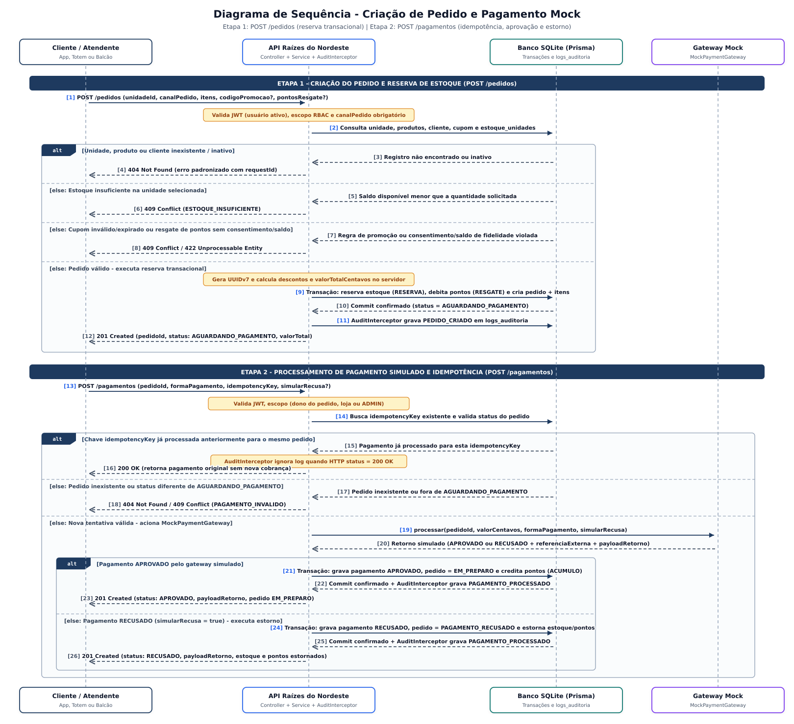

# Raízes do Nordeste API

**Instituição:** Centro Universitário Internacional UNINTER - Escola Superior Politécnica (ESP)  
**Disciplina:** Projeto Multidisciplinar - Trilha Back-End (ADS)  
**Autor:** Mateus Mendonça Dias Rezende (RU: `4841127`) | **Professora:** Prof. Me. Luciane Yanase Kanashiro | **Ano:** 2026  
**Entrega (ABNT):** `4841127_Projeto_Back_End.PDF`

## Sumário

1. [Introdução e Objetivos](#1-introdução-e-objetivos) · 2. [Análise e Requisitos](#2-análise-e-requisitos) · 3. [Modelagem e Arquitetura](#3-modelagem-e-arquitetura) · 4. [API e Endpoints](#4-api-e-endpoints) · 5. [LGPD e Segurança](#5-lgpd-e-segurança) · 6. [Entrega Técnica e Execução](#6-entrega-técnica-e-execução) · 7. [Plano de Testes](#7-plano-de-testes) · 8. [Conclusão](#8-conclusão) · 9. [Referências](#9-referências)

---

## 1. Introdução e Objetivos

A rede **Raízes do Nordeste** atua no modelo de matriz e unidades, atendendo os canais `APP`, `TOTEM`, `BALCAO`, `PICKUP` e `WEB`. Esta API REST em **NestJS, TypeScript e Prisma (SQLite)** centraliza catálogo, promoções e fidelidade na matriz, mantendo estoque e fila de preparo isolados por loja, com exigência de `canalPedido`, pagamento simulado idempotente, RBAC, controles LGPD, auditoria, Swagger (`/docs`) e testes reproduzíveis.

---

## 2. Análise e Requisitos

Especificação completa: [`docs/requirements/requirements.md`](./docs/requirements/requirements.md).

- **Requisitos Funcionais:** cadastro/login JWT e gestão de equipe por loja (`CLIENTE`, `ATENDENTE`, `COZINHA`, `GERENTE`, `ADMIN`); unidades e catálogo único da matriz com cardápio público por loja (`GET /unidades/:id/cardapio`); movimentação/saldo de estoque por unidade; criação de pedidos com `canalPedido` obrigatório, cálculo server-side, filtros (`?canalPedido=&status=&unidadeId=`) e ciclo de status (`AGUARDANDO_PAGAMENTO` -> `EM_PREPARO` -> `PRONTO` -> `ENTREGUE` | `PAGAMENTO_RECUSADO` | `CANCELADO`); cupons (`PERCENTUAL`/`VALOR_FIXO`); pagamento mock idempotente (`PaymentGateway`); fidelidade com consentimento (`1 pt / R$ 10`, resgate `1 pt = R$ 0,50`) e trilha de auditoria.
- **Requisitos Não Funcionais:** `bcryptjs` (custo 10), JWT validado contra usuário ativo/não anonimizado, RBAC por perfil/loja, omissão de `senhaHash`, transações Prisma nos fluxos críticos, IDs UUIDv7 (`uuidv7`), paginação (`?page=1&limit=10`), `X-Request-Id` e padrão único de erro (`GlobalExceptionFilter`).
- **Regras de Negócio:** **RN01** `canalPedido` obrigatório (`422`); **RN02** estoque isolado por `(unidadeId, produtoId)`; **RN03** reserva na criação e estorno em recusa/cancelamento (incluindo pontos acumulados; `CLIENTE` não cancela `PRONTO`); **RN04** preços congelados em centavos (`Int`); **RN05** `idempotencyKey` devolve `200 OK` sem recobrar/reauditar; **RN06** resgate exige `consentimentoAtivo = true` (`409`).

| Escopo / Decisão | Escolha | Justificativa |
|---|---|---|
| **MVP entregue** | Fluxos completos de Pedido -> Pagamento Mock -> Status e Estoque por Unidade + Fidelidade, LGPD e Auditoria | Atende todos os requisitos essenciais em execução 100% local. |
| **Fase 2 (proposto)** | Gateway real (webhooks), WebSocket/SSE para cozinha, blocklist JWT em Redis e PostgreSQL | Portas em `src/application/ports` permitem trocar adapters sem mudar o domínio. |
| **Stack e modelo** | NestJS 12 + Prisma 6 (SQLite), UUIDv7 (`uuidv7`), valores em centavos (`Int`) | DI/Swagger nativos, banco relacional local sem Docker e ausência de erro de ponto flutuante. |

---

## 3. Modelagem e Arquitetura

Índice e fontes em texto: [`docs/diagrams/README.md`](./docs/diagrams/README.md) (imagens renderizadas em [`docs/diagrams/img/`](./docs/diagrams/img)).

### 3.1 Casos de Uso e Fluxos Críticos


Fontes: [`docs/diagrams/use-cases.puml`](./docs/diagrams/use-cases.puml) · [`docs/requirements/use-cases.md`](./docs/requirements/use-cases.md). Cobre `UC01`–`UC14` entre `Cliente`, `Atendente`, `Cozinha`, `Gerente`, `Administrador` e `Gateway Mock`, detalhando pré/pós-condições e exceções de `UC04 + UC07` (Pedido + Pagamento) e `UC09` (Status/Cancelamento).

### 3.2 Modelo de Dados (DER)


Fontes: [`docs/diagrams/der.dbml`](./docs/diagrams/der.dbml) · [`prisma/schema.prisma`](./prisma/schema.prisma) · [`migration.sql`](./prisma/migrations/20261122000853_init/migration.sql). Define **12 tabelas** com PK UUIDv7 e FKs: `unidades`, `usuarios`, `produtos`, `estoque_unidades` (`unique(unidade_id, produto_id)`), `promocoes`, `pedidos`, `itens_pedido`, `movimentacoes_estoque`, `pagamentos` (`unique(idempotency_key)`), `contas_fidelidade`, `movimentacoes_fidelidade` e `logs_auditoria`.

### 3.3 Arquitetura em 4 Camadas


Fonte: [`docs/diagrams/architecture.mmd`](./docs/diagrams/architecture.mmd).

- **`src/domain`:** enums puros, erros tipados, cálculo de descontos/pontos e regras de status, sem dependência de HTTP ou ORM.
- **`src/application`:** casos de uso por módulo, helpers compartilhados (`acesso-escopo`, `paginacao`, `estorno`) e portas (`IdGenerator`, `PasswordHasher`, `AuditLogger`, `PaymentGateway`).
- **`src/infrastructure`:** `PrismaService` (SQLite), `env.config`, `JwtStrategy`, `BcryptPasswordHasher`, `UuidV7Generator` (`uuidv7`), `PrismaAuditLogger` e `MockPaymentGateway`.
- **`src/api`:** controllers REST, DTOs (`class-validator`), guards (`JwtAuthGuard`, `RolesGuard`), `requestIdMiddleware`, `AuditInterceptor`, `GlobalExceptionFilter` e Swagger.

### 3.4 Classes e Sequência




Fontes: [`docs/diagrams/classes.mmd`](./docs/diagrams/classes.mmd) · [`docs/diagrams/sequence-order-payment.mmd`](./docs/diagrams/sequence-order-payment.mmd).

---

## 4. API e Endpoints

URLs no plural, paginação `?page=1&limit=10`, header `X-Request-Id`, Swagger em `/docs` e erro padrão `{ error, message, details, timestamp, path, requestId }`.

| Módulo | Endpoints | Auth / Perfis |
|---|---|---|
| **Health / Auth** | `GET /health`, `POST /auth/register`, `POST /auth/login` | Público |
| **Usuários** | `GET /usuarios/me`, `DELETE /usuarios/me` / `POST /usuarios` | JWT (todos) / JWT (`ADMIN`, `GERENTE` da loja) |
| **Unidades / Produtos** | `GET /unidades`, `GET /unidades/:id/cardapio`, `GET /produtos` / `POST /unidades`, `POST /produtos` / `GET /unidades/:id/estoque` | Público / `ADMIN` / `ADMIN` ou equipe da loja |
| **Estoque / Promoções** | `POST /estoque/movimentacoes` / `GET /promocoes` / `POST /promocoes` | `ADMIN`, `GERENTE` / Público / `ADMIN` |
| **Pedidos** | `POST /pedidos`, `GET /pedidos` (`?canalPedido=&status=&unidadeId=`), `GET /pedidos/:id`, `PATCH /pedidos/:id/status`, `POST /pedidos/:id/cancelar` | JWT com escopo de dono/unidade e transição por perfil |
| **Pagamentos** | `POST /pagamentos` (`idempotencyKey`, `simularRecusa`) | JWT (dono, loja ou `ADMIN`) |
| **Fidelidade / Auditoria** | `GET /fidelidade/conta`, `PATCH /fidelidade/consentimento`, `GET /fidelidade/movimentacoes` / `GET /auditoria` | JWT (todos) / `ADMIN` geral e `GERENTE` da própria loja |

**Exemplos de contrato (`POST /auth/login`, `POST /pedidos`, `POST /pagamentos` e erro `409`):**

```json
// POST /auth/login -> 200 OK
// Request: { "email": "cliente@exemplo.com", "senha": "Senha@123" }
{
  "accessToken": "eyJhbGciOiJIUzI1NiIsInR5cCI6IkpXVCJ9...",
  "tokenType": "Bearer",
  "expiresIn": 3600,
  "user": { "id": "019c6199-df00-7000-8000-000000000305", "nome": "Maria Cliente", "email": "cliente@exemplo.com", "perfil": "CLIENTE", "unidadeId": null }
}
```

```json
// POST /pedidos -> 201 Created
// Request: { "unidadeId": "019c6199-df00-7000-8000-000000000101", "canalPedido": "TOTEM", "codigoPromocao": "TOTEM10", "pontosResgate": 5, "itens": [{ "produtoId": "019c6199-df00-7000-8000-000000000201", "quantidade": 2 }] }
{
  "id": "019c6199-df00-7a00-8f41-9c2a1b3e4f77",
  "unidadeId": "019c6199-df00-7000-8000-000000000101",
  "canalPedido": "TOTEM",
  "status": "AGUARDANDO_PAGAMENTO",
  "subtotalCentavos": 4980,
  "descontoPromocaoCentavos": 498,
  "pontosUtilizados": 5,
  "descontoFidelidadeCentavos": 250,
  "valorTotalCentavos": 4232,
  "valorTotal": 42.32
}
```

```json
// POST /pagamentos -> 201 Created (ou 200 OK na retentativa idempotente)
// Request: { "pedidoId": "019c6199-df00-7a00-8f41-9c2a1b3e4f77", "formaPagamento": "PIX", "idempotencyKey": "pm-ok-1771164000000" }
{
  "id": "019c6199-df00-7a00-8f41-9c2a1b3e4f88",
  "pedidoId": "019c6199-df00-7a00-8f41-9c2a1b3e4f77",
  "unidadeId": "019c6199-df00-7000-8000-000000000101",
  "status": "APROVADO",
  "valorCentavos": 4232,
  "referenciaExterna": "MOCK-PIX-1771164000000",
  "payloadRetorno": { "provider": "raizes-mock-gateway", "aprovado": true, "motivo": null }
}
```

```json
// Erro padrão (409 Conflict)
{
  "error": "ESTOQUE_INSUFICIENTE",
  "message": "Estoque insuficiente na unidade selecionada.",
  "details": [{ "field": "itens", "issue": "Bolo de Rolo Tradicional: solicitado 5, disponível 2" }],
  "timestamp": "2026-02-15T14:00:00.000Z",
  "path": "/pedidos",
  "requestId": "019c6199-df00-7a00-8f41-9c2a1b3e4f99"
}
```

---

## 5. LGPD e Segurança

Documento completo: [`docs/lgpd/lgpd-security.md`](./docs/lgpd/lgpd-security.md).

| Dados Coletados | Finalidade | Base Legal (Art. 7º LGPD) |
|---|---|---|
| `nome`, `email`, `senhaHash`, `perfil`, `unidadeId` | Conta, login JWT e RBAC | Execução de contrato (V) e obrigação legal (II) |
| `pedidos` e `pagamentos` (sem dados de cartão) | Atendimento e controle financeiro | Execução de contrato (V) |
| `contas_fidelidade` (`consentimentoAtivo`, timestamps) | Acúmulo e resgate de pontos | Consentimento explícito (I) |
| `logs_auditoria` (`usuarioId`, `acao`, `requestId`, `metadados`) | Rastreabilidade de ações sensíveis | Legítimo interesse e segurança (IX) |

**Controles aplicados:** minimização (sem CPF/endereço residencial/cartão), hash `bcryptjs` (custo 10), exclusão de `senhaHash` via `USUARIO_SEGURO_SELECT`, RBAC global (`JwtAuthGuard` + `RolesGuard`), anonimização em `DELETE /usuarios/me` (mascara nome/e-mail, descarta senha, revoga fidelidade e invalida JWT imediatamente com `401 NAO_AUTENTICADO`) e `AuditInterceptor` com allowlist e filtro por `unidadeId` para `GERENTE`.

---

## 6. Entrega Técnica e Execução

- **Repositório:** https://github.com/mmrezende/raizes-nordeste-api
- **API / Swagger local:** `http://localhost:3000` | `http://localhost:3000/docs` (`SWAGGER_PATH`)
- **Coleção Postman:** [`test/postman/raizes-nordeste-api.postman_collection.json`](./test/postman/raizes-nordeste-api.postman_collection.json) ([link público](https://github.com/mmrezende/raizes-nordeste-api/blob/main/test/postman/raizes-nordeste-api.postman_collection.json))
- **Pré-requisitos:** **Node.js 24+ (LTS)** e `npm`
- **Variáveis (`.env.example`):** `NODE_ENV=development`, `PORT=3000`, `SWAGGER_PATH=docs`, `DATABASE_URL="file:./dev.db"`, `JWT_SECRET`, `JWT_EXPIRES_IN_SECONDS=3600`

```bash
git clone https://github.com/mmrezende/raizes-nordeste-api.git && cd raizes-nordeste-api
cp .env.example .env && npm install
npm run prisma:generate && npx prisma migrate deploy && npm run prisma:seed
npm run start:dev   # produção: npm run build && npm run start:prod
```

**Seed (`prisma/seed.ts` — senha padrão `Senha@123`):** `admin@raizes.com` (`ADMIN`), `gerente.rec@raizes.com` (`GERENTE`, `REC-01`), `atendente.rec@raizes.com` (`ATENDENTE`, `REC-01`), `cozinha.rec@raizes.com` (`COZINHA`, `REC-01`) e `cliente@exemplo.com` (`CLIENTE`, 20 pts, consentimento ativo). Unidades: `REC-01` (`019c6199-df00-7000-8000-000000000101`) e `FOR-01`; cupons: `TOTEM10` e `RAIZES5`; *Bolo de Rolo Tradicional* em `REC-01` inicia com saldo `2` para testar `409`.

---

## 7. Plano de Testes

Documento completo: [`docs/tests/test-plan.md`](./docs/tests/test-plan.md).

```bash
npm run lint && npm test && npm run test:e2e
```

- **Automatizados (Jest):** **7 suítes unitárias (34 testes)** e **6 suítes E2E HTTP (35 testes)** em banco SQLite isolado (`prisma/test-e2e.db`, preservando `prisma/dev.db`).
- **Postman:** suba a API com seed aplicado, importe a coleção e execute as pastas `1` a `7` em ordem (`pm.test` e variáveis automáticas).

| ID | Cenário | Endpoint | Saída Esperada | Evidência (Postman) |
|---|---|---|---|---|
| `T01` | Login válido | `POST /auth/login` | `200` + `accessToken`, `expiresIn: 3600` | `1. Auth / T01` |
| `T02` | Cardápio por unidade | `GET /unidades/{id}/cardapio` | `200` + itens paginados | `2. Unidades / T02` |
| `T03` | Sem token | `GET /unidades/{id}/estoque` | `401 NAO_AUTENTICADO` | `2. Unidades / T03` |
| `T04` | Criar pedido `TOTEM` | `POST /pedidos` | `201` + `AGUARDANDO_PAGAMENTO` | `3. Pedidos / T04` |
| `T05` | Filtrar por canal | `GET /pedidos?canalPedido=TOTEM` | `200` + pedidos `TOTEM` | `3. Pedidos / T05` |
| `T06` | `canalPedido` ausente | `POST /pedidos` | `422 ERRO_VALIDACAO` | `3. Pedidos / T06` |
| `T07` | Quantidade negativa | `POST /pedidos` | `422 ERRO_VALIDACAO` | `3. Pedidos / T07` |
| `T08` | Produto inexistente | `POST /pedidos` | `404 PRODUTO_NAO_ENCONTRADO` | `3. Pedidos / T08` |
| `T09` | Estoque insuficiente | `POST /pedidos` | `409 ESTOQUE_INSUFICIENTE` | `3. Pedidos / T09` |
| `T10` | Pagamento aprovado | `POST /pagamentos` | `201 APROVADO`, `payloadRetorno`, `EM_PREPARO` | `4. Pagamentos / T10` |
| `T11` | Retry idempotente | `POST /pagamentos` | `200` + mesmo `id`, sem log extra | `4. Pagamentos / T11` |
| `T12` | Pagamento recusado | `POST /pagamentos` | `201 RECUSADO`, `PAGAMENTO_RECUSADO`, estorno | `4. Pagamentos / T12` |
| `T13` | Sem permissão | `PATCH /pedidos/{id}/status` | `403 ACESSO_NEGADO` | `5. Status / T13` |
| `T14` | Cozinha -> `PRONTO` | `PATCH /pedidos/{id}/status` | `200` + `PRONTO` | `5. Status / T14` |
| `T15` | Atendente -> `ENTREGUE` | `PATCH /pedidos/{id}/status` | `200` + `ENTREGUE` | `5. Status / T15` |
| `T16` | Auditoria da loja | `GET /auditoria?entidade=pedidos` | `200` + logs `REC-01` | `7. Auditoria / T16` |

*(Pasta `6. Fidelidade e LGPD` valida saldo, consentimento e extrato paginado com asserts `pm.test`.)*

---

## 8. Conclusão

A API atende aos fluxos críticos da rede **Raízes do Nordeste** (Pedido Multicanal -> Reserva -> Pagamento Mock Idempotente -> Status e Estoque por Unidade), deixando integrações externas reais, notificações assíncronas e blocklist em Redis para a Fase 2. O DER (12 tabelas), os casos de uso (`UC01`–`UC14`) e o diagrama de classes conectam-se diretamente às rotas e camadas (`domain` isolado do ORM/HTTP), com pagamento mock desacoplado via `PaymentGateway`, erros padronizados no `GlobalExceptionFilter`, controles de LGPD/RBAC/auditoria aplicados e 69 testes automatizados somados à coleção Postman (`T01`–`T16`).

---

## 9. Referências

- BRASIL. **Lei nº 13.709, de 14 de agosto de 2018** (LGPD). Brasília, DF, 2018.
- FOWLER, M. **UML Essencial**. 3. ed. Porto Alegre: Bookman, 2005.
- NESTJS. **NestJS Documentation**. Disponível em: https://docs.nestjs.com. Acesso em: nov. 2026.
- OPENAPI INITIATIVE. **OpenAPI Specification v3.0**. Disponível em: https://spec.openapis.org/oas/latest.html. Acesso em: nov. 2026.
- PRESSMAN, R. S.; MAXIM, B. R. **Engenharia de Software**. 9. ed. Porto Alegre: AMGH, 2021.
- PRISMA. **Prisma ORM Documentation**. Disponível em: https://www.prisma.io/docs. Acesso em: nov. 2026.
- SOMMERVILLE, I. **Engenharia de Software**. 10. ed. São Paulo: Pearson, 2018.
