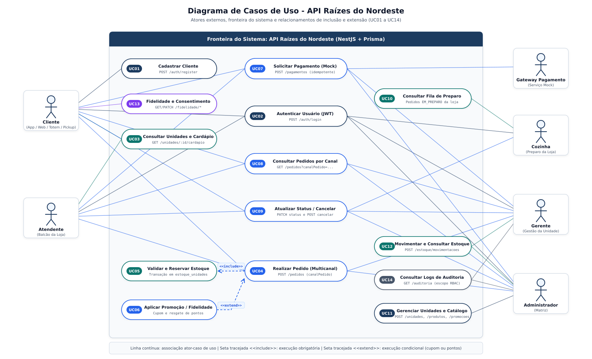
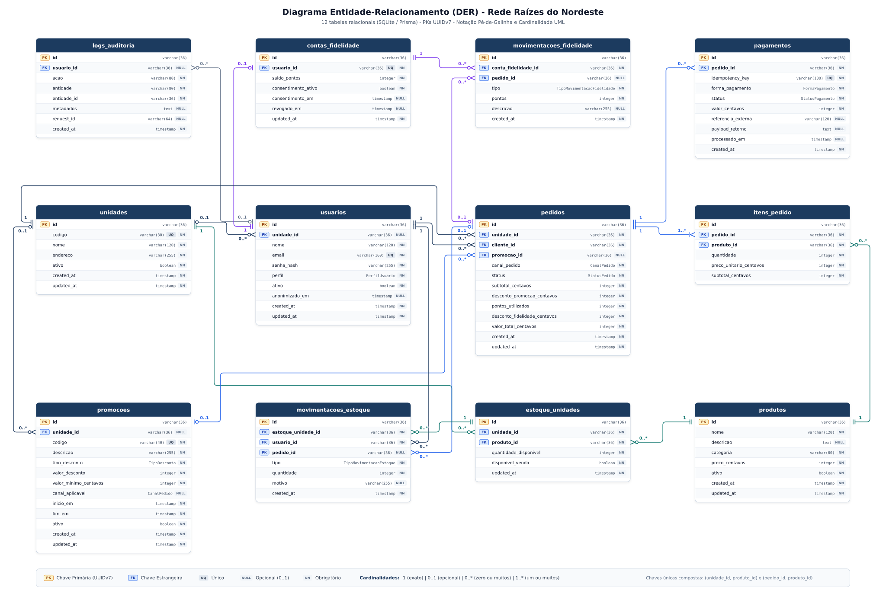
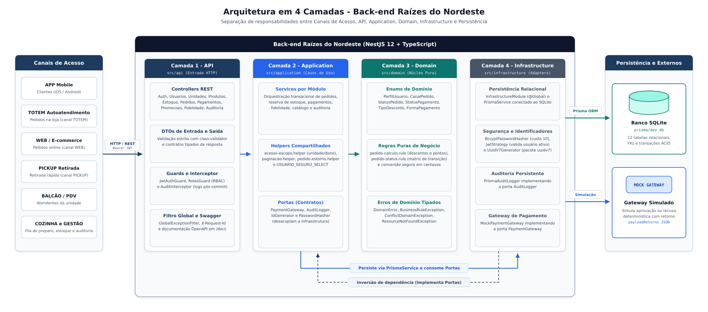
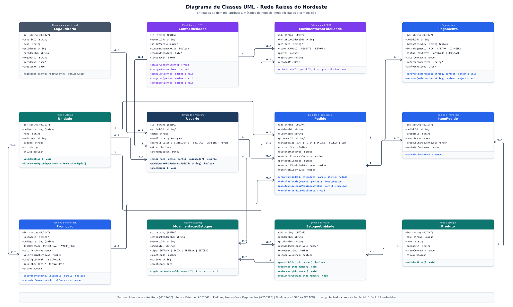
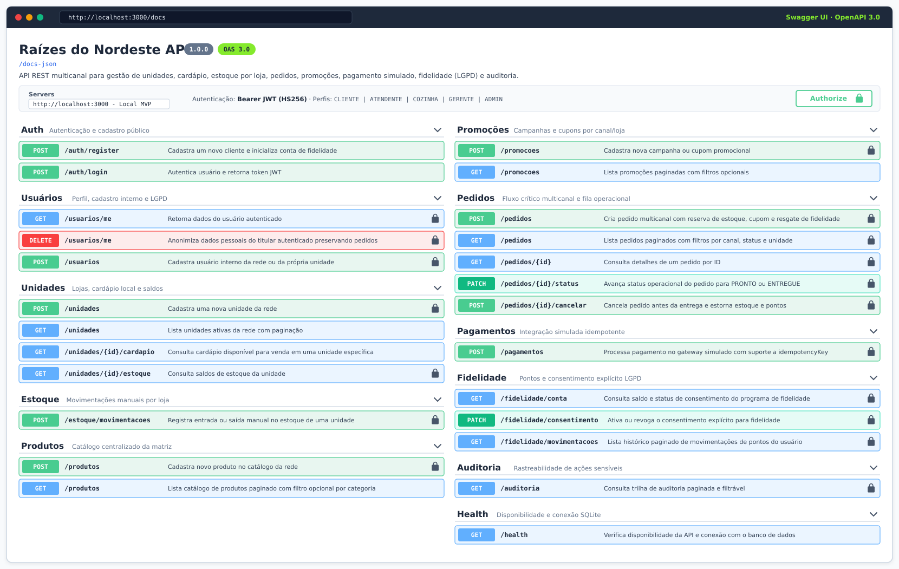
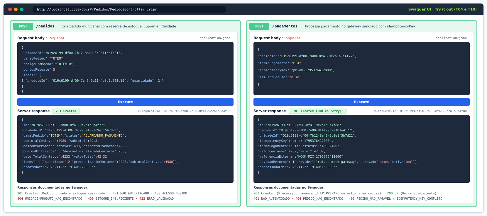

# Raízes do Nordeste API

**Instituição:** Centro Universitário Internacional UNINTER - Escola Superior Politécnica (ESP)  
**Disciplina:** Projeto Multidisciplinar - Trilha Back-End (Análise e Desenvolvimento de Sistemas)  
**Aluno:** Mateus Mendonça Dias Rezende (RU: `4841127`)  
**Professora:** Prof. Me. Luciane Yanase Kanashiro | **Ano:** 2026

## Sumário

1. [Introdução e Objetivos](#1-introdução-e-objetivos)
2. [Análise e Requisitos](#2-análise-e-requisitos)
3. [Modelagem e Arquitetura](#3-modelagem-e-arquitetura)
4. [API e Endpoints](#4-api-e-endpoints)
5. [LGPD e Segurança](#5-lgpd-e-segurança)
6. [Entrega Técnica e Execução](#6-entrega-técnica-e-execução)
7. [Plano de Testes](#7-plano-de-testes)
8. [Conclusão](#8-conclusão)
9. [Referências](#9-referências)

---
<br>

## 1. Introdução e Objetivos

A rede de lanchonetes **Raízes do Nordeste** expandiu sua operação para várias lojas físicas, vendendo ao mesmo tempo por aplicativo, totem de autoatendimento, balcão, site e retirada rápida (`PICKUP`). Como cada canal operava sem uma base centralizada, começaram a ocorrer diferenças de preço entre lojas, vendas de itens sem estoque na unidade escolhida, falhas na validação de cupons e falta de registro formal de consentimento dos clientes no programa de fidelidade.

Para resolver esse cenário, desenvolvi esta API REST em **NestJS 12, TypeScript e Prisma ORM (SQLite)**. A ideia foi manter o catálogo de produtos, as campanhas promocionais e a conta de fidelidade centralizados na matriz, mas isolar o saldo de estoque e a fila de preparo por unidade física, exigindo a identificação do canal do pedido, simulando pagamentos com chave de idempotência e aplicando os controles exigidos pela LGPD.

---
<br>

## 2. Análise e Requisitos

O controle de acesso foi dividido em cinco perfis (`CLIENTE`, `ATENDENTE`, `COZINHA`, `GERENTE` e `ADMIN`), amarrando os funcionários de loja ao `unidadeId` onde trabalham. Embora o cadastro de produtos venha da matriz, a disponibilidade e a quantidade ficam na tabela `estoque_unidades`. Assim, quando o cliente consulta o cardápio público de uma filial (`GET /unidades/:id/cardapio`), a API filtra apenas os itens ativos e com saldo disponível para venda naquela loja.

Na criação do pedido (`POST /pedidos`), o campo `canalPedido` (`APP`, `TOTEM`, `BALCAO`, `PICKUP` ou `WEB`) é obrigatório e retorna `422 ERRO_VALIDACAO` se não for enviado. Todo o cálculo de valores — subtotal dos itens, desconto de cupom (`PERCENTUAL` ou `VALOR_FIXO`) e abatimento de pontos de fidelidade — é feito no back-end usando centavos inteiros (`Int`) para evitar erros de arredondamento com ponto flutuante, já reservando o estoque dentro da mesma transação. No pagamento (`POST /pagamentos`), o envio de uma `idempotencyKey` impede cobranças duplicadas: quando o gateway simulado aprova a transação, o pedido avança para `EM_PREPARO` e credita 1 ponto a cada R$ 10,00 pagos (desde que o cliente tenha consentimento ativo); se o pagamento for recusado ou o pedido for cancelado antes da entrega, o sistema devolve o estoque reservado e estorna os pontos na hora.

Como recorte do MVP para a disciplina, priorizei fechar todos os fluxos de negócio, persistência transacional, testes e auditoria rodando localmente em SQLite com chaves UUIDv7. Recursos que dependem de serviços externos — como webhooks de adquirentes reais, painel de cozinha via WebSocket, lista de revogação de tokens em Redis e migração para PostgreSQL — ficaram planejados para uma segunda fase, aproveitando as interfaces (`ports`) já separadas na camada de aplicação.

<div class="page"></div>
<br>

## 3. Modelagem e Arquitetura

### 3.1 Casos de Uso e Fluxos Críticos

O diagrama abaixo mapeia os seis atores (`Cliente`, `Atendente`, `Cozinha`, `Gerente`, `Administrador` e `Gateway Mock`) e os casos de uso `UC01` a `UC14`.



- **Pedido e Pagamento (`UC04` e `UC07`):** requer usuário ativo, unidade/produtos ativos e saldo local (além de consentimento ativo caso resgate pontos). `POST /pedidos` cria o registro em `AGUARDANDO_PAGAMENTO`, reserva o estoque (`UC05`) e debita pontos (`UC06`) em transação única. `POST /pagamentos` valida a `idempotencyKey` (retornando `200 OK` se já processada) e aciona o gateway mock: aprovado (`201`) avança para `EM_PREPARO` e pontua; recusado (`simularRecusa: true`) muda para `PAGAMENTO_RECUSADO` e estorna estoque e pontos.
- **Status e Cancelamento (`UC09`):** a cozinha avança `EM_PREPARO -> PRONTO` e o balcão conclui `PRONTO -> ENTREGUE` (`PATCH /pedidos/:id/status`), bloqueando desvios com `403` ou `409`. O cancelamento (`POST /pedidos/:id/cancelar`) ocorre antes da entrega (para o cliente, apenas antes de `PRONTO`), revertendo estoque e pontos em transação.

<div class="page"></div>
<br>

### 3.2 Modelo de Dados (DER)

O banco possui 12 tabelas relacionais com chaves primárias UUIDv7 e restrições `unique(unidade_id, produto_id)` em `estoque_unidades`, `unique(pedido_id, produto_id)` em `itens_pedido` e `unique(idempotency_key)` em `pagamentos`.



<div class="page"></div>
<br>

### 3.3 Arquitetura em 4 Camadas

A aplicação separa **Domain** (`src/domain`, regras puras de cálculo/status e erros sem ORM/HTTP), **Application** (`src/application`, services, escopo por unidade e portas), **Infrastructure** (`src/infrastructure`, Prisma, Bcrypt, JWT, UUIDv7 e `MockPaymentGateway`) e **API** (`src/api`, controllers, DTOs, guards, interceptor de auditoria, filtro global e Swagger).



<div class="page"></div>
<br>

### 3.4 Diagrama de Classes

Representação das entidades, atributos, métodos e multiplicidades nos cinco pacotes do domínio.



<div class="page"></div>
<br>

### 3.5 Diagrama de Sequência

Fluxo transacional de `POST /pedidos` e `POST /pagamentos`, detalhando validações (`404`, `409`, `422`), idempotência (`200 OK`), aprovação/estorno e gravação de auditoria.


<div class="page"></div>
<br>

## 4. API e Endpoints

As rotas seguem o padrão REST com recursos no plural, paginação via `?page=1&limit=10`, rastreamento pelo header `X-Request-Id` e documentação OpenAPI gerada pelo `@nestjs/swagger` em `http://localhost:3000/docs`:

- **Auth e Usuários:** `GET /health`, `POST /auth/register` (`201`) e `POST /auth/login` (`200`) são públicos; `GET /usuarios/me` (`200`) e `DELETE /usuarios/me` (`200`) exigem token JWT do titular; `POST /usuarios` (`201`) é restrito a `ADMIN` e `GERENTE`.
- **Unidades, Catálogo, Estoque e Promoções:** `GET /unidades`, `GET /unidades/:id/cardapio`, `GET /produtos` e `GET /promocoes` (`200`) são públicos; `POST /unidades`, `POST /produtos` e `POST /promocoes` (`201`) exigem `ADMIN`; `GET /unidades/:id/estoque` (`200`) permite equipe da própria loja ou `ADMIN`; `POST /estoque/movimentacoes` (`201`) permite `GERENTE` da loja ou `ADMIN`.
- **Pedidos e Pagamentos:** `POST /pedidos` (`201`), `GET /pedidos` (`200`, com filtros `?canalPedido=&status=&unidadeId=`), `GET /pedidos/:id` (`200`), `PATCH /pedidos/:id/status` (`200`, restrito à operação da loja), `POST /pedidos/:id/cancelar` (`200`) e `POST /pagamentos` (`201` no processamento inédito ou `200` em retentativa idempotente).
- **Fidelidade e Auditoria:** `GET /fidelidade/conta`, `PATCH /fidelidade/consentimento` e `GET /fidelidade/movimentacoes` (`200`, titular JWT); `GET /auditoria` (`200`, `ADMIN` geral e `GERENTE` escopado à sua unidade).





```json
// POST /auth/login -> 200 OK | Request: { "email": "cliente@exemplo.com", "senha": "Senha@123" }
{
  "accessToken": "eyJhbGciOiJIUzI1NiIsInR5cCI6IkpXVCJ9...",
  "tokenType": "Bearer",
  "expiresIn": 3600,
  "user": { "id": "019c6199-df00-7d34-9b18-6f4a2e1c8d52", "nome": "Dr. João Pedro Albuquerque", "email": "cliente@exemplo.com", "perfil": "CLIENTE", "unidadeId": null }
}
```

```json
// POST /pedidos -> 201 Created | Request: { "unidadeId": "019c6199-df00-7b12-8a40-3c9e1f5b7d21", "canalPedido": "TOTEM", "codigoPromocao": "TOTEM10", "pontosResgate": 5, "itens": [{ "produtoId": "019c6199-df00-7c45-9e11-4a8b2d6f3c19", "quantidade": 2 }] }
{
  "id": "019c6199-df00-7a00-8f41-9c2a1b3e4f77",
  "unidadeId": "019c6199-df00-7b12-8a40-3c9e1f5b7d21",
  "canalPedido": "TOTEM",
  "status": "AGUARDANDO_PAGAMENTO",
  "subtotalCentavos": 4980,
  "descontoPromocaoCentavos": 498,
  "pontosUtilizados": 5,
  "descontoFidelidadeCentavos": 250,
  "valorTotalCentavos": 4232,
  "valorTotal": 42.32
}
```

```json
// POST /pagamentos -> 201 Created (ou 200 OK no retry idempotente) | Request: { "pedidoId": "019c6199-df00-7a00-8f41-9c2a1b3e4f77", "formaPagamento": "PIX", "idempotencyKey": "pm-ok-1795376412000" }
{
  "id": "019c6199-df00-7a00-8f41-9c2a1b3e4f88",
  "pedidoId": "019c6199-df00-7a00-8f41-9c2a1b3e4f77",
  "unidadeId": "019c6199-df00-7b12-8a40-3c9e1f5b7d21",
  "status": "APROVADO",
  "valorCentavos": 4232,
  "referenciaExterna": "MOCK-PIX-1795376412000",
  "payloadRetorno": { "provider": "raizes-mock-gateway", "aprovado": true, "motivo": null }
}
```

```json
// Erro padronizado (401, 403, 404, 409, 422) -> Exemplo 409 Conflict
{
  "error": "ESTOQUE_INSUFICIENTE",
  "message": "Estoque insuficiente na unidade selecionada.",
  "details": [{ "field": "itens", "issue": "Bolo de Rolo Tradicional: solicitado 5, disponível 2" }],
  "timestamp": "2026-11-22T19:42:10.000Z",
  "path": "/pedidos",
  "requestId": "019c6199-df00-7a00-8f41-9c2a1b3e4f99"
}
```

<div class="page"></div>
<br>

## 5. LGPD e Segurança

A API aplica minimização de dados (Lei nº 13.709/2018), coletando apenas nome, e-mail e senha para conta e pedidos sob as bases de execução de contrato (Art. 7º, V) e obrigação legal (Art. 7º, II), sem armazenar CPF, endereço residencial ou cartão. A fidelidade exige consentimento explícito (Art. 7º, I): `consentimentoAtivo` inicia falso, é gerenciado em `PATCH /fidelidade/consentimento` com timestamps (`consentimentoEm`, `revogadoEm`) e bloqueia pontuação ou resgate quando inativo (`409`).

O endpoint `DELETE /usuarios/me` anonimiza o titular (`nome = "Usuário Anonimizado"`, `email = anonimizado-<id>@anon.local`, descarte de senha, revogação da fidelidade e `ativo = false`), preservando o histórico contábil dos pedidos. Como a `JwtStrategy` valida se o usuário segue ativo no banco, tokens anteriores à anonimização passam a retornar `401 NAO_AUTENTICADO` imediatamente. Senhas usam `bcryptjs` (custo 10) e são omitidas nas projeções do Prisma, e a auditoria (legítimo interesse, Art. 7º, IX) registra apenas metadados de uma allowlist sem gravar segredos.

---
<br>

## 6. Entrega Técnica e Execução

- **Repositório GitHub:** https://github.com/mmrezende/raizes-nordeste-api
- **API e Swagger local:** `http://localhost:3000` e `http://localhost:3000/docs`
- **Coleção Postman:** [`test/postman/raizes-nordeste-api.postman_collection.json`](./test/postman/raizes-nordeste-api.postman_collection.json)
- **Ambiente:** **Node.js 24+ (LTS)** e `npm` (`.env.example` define `PORT=3000`, `SWAGGER_PATH=docs`, `DATABASE_URL="file:./dev.db"`, `JWT_SECRET` e `JWT_EXPIRES_IN_SECONDS=3600`).

```bash
git clone https://github.com/mmrezende/raizes-nordeste-api.git && cd raizes-nordeste-api
cp .env.example .env && npm install
npm run prisma:generate && npx prisma migrate deploy && npm run prisma:seed
npm run start:dev
```

O seed (`prisma/seed.ts`, com `@faker-js/faker` semeado pelo RU `4841127` e chaves UUIDv7 geradas em runtime) cadastra as unidades `REC-01` e `FOR-01`, o catálogo regional, os cupons `TOTEM10` e `RAIZES5`, e cinco contas de teste (senha `Senha@123`): `admin@raizes.com`, `gerente.rec@raizes.com`, `atendente.rec@raizes.com`, `cozinha.rec@raizes.com` e `cliente@exemplo.com` (20 pontos e consentimento ativo), além de estoque reduzido (`2` unidades) para o *Bolo de Rolo Tradicional* em Recife.

<div class="page"></div>
<br>

## 7. Plano de Testes

Os testes automatizados somam 7 suítes unitárias (34 testes) e 6 suítes E2E HTTP (35 testes). A suíte E2E roda em banco SQLite separado (`prisma/test-e2e.db`) para não apagar o `prisma/dev.db` usado na avaliação manual:

```bash
npm run lint && npm test && npm run test:e2e
```

No Postman, basta importar a coleção e executar as pastas `1` a `7` em ordem (9 cenários positivos e 7 negativos):

| ID | Cenário | Rota | Pré-condição e Entrada | Saída Esperada e Evidência |
|---|---|---|---|---|
| `T01` | Login válido de cliente | `POST /auth/login` | Seed aplicado; `cliente@exemplo.com` | `200 OK` com `accessToken` (`1. Auth / T01`) |
| `T02` | Cardápio disponível da loja | `GET /unidades/:id/cardapio` | Unidade `REC-01` com estoque ativo | `200 OK` com itens e saldo (`2. Unidades / T02`) |
| `T03` | Rota protegida sem token | `GET /unidades/:id/estoque` | Requisição sem header Bearer | `401 NAO_AUTENTICADO` (`2. Unidades / T03`) |
| `T04` | Pedido `TOTEM` com cupom/pontos | `POST /pedidos` | Token cliente; `TOTEM`, `TOTEM10`, 5 pts | `201 Created`, total `4232` (`3. Pedidos / T04`) |
| `T05` | Filtro de pedidos por canal | `GET /pedidos` | Query `?canalPedido=TOTEM` | `200 OK` apenas com canal `TOTEM` (`3. Pedidos / T05`) |
| `T06` | Pedido sem `canalPedido` | `POST /pedidos` | Body omitindo `canalPedido` | `422 ERRO_VALIDACAO` (`3. Pedidos / T06`) |
| `T07` | Quantidade negativa no item | `POST /pedidos` | Body com `quantidade: -1` | `422 ERRO_VALIDACAO` (`3. Pedidos / T07`) |
| `T08` | Produto inexistente | `POST /pedidos` | `produtoId` UUIDv7 não cadastrado | `404 PRODUTO_NAO_ENCONTRADO` (`3. Pedidos / T08`) |
| `T09` | Estoque insuficiente na loja | `POST /pedidos` | 5x *Bolo de Rolo* (saldo disponível: 2) | `409 ESTOQUE_INSUFICIENTE` (`3. Pedidos / T09`) |
| `T10` | Pagamento mock aprovado | `POST /pagamentos` | Pedido de `T04`, `PIX`, `idempotencyKey` | `201 APROVADO`, pedido `EM_PREPARO` (`4. Pagamentos / T10`) |
| `T11` | Retentativa idempotente | `POST /pagamentos` | Reenvio da mesma `idempotencyKey` | `200 OK` com mesmo ID, sem recobrar (`4. Pagamentos / T11`) |
| `T12` | Pagamento recusado e estorno | `POST /pagamentos` | Novo pedido com `simularRecusa: true` | `201 RECUSADO` e estoque devolvido (`4. Pagamentos / T12`) |
| `T13` | Status alterado sem permissão | `PATCH /pedidos/:id/status` | Token de `CLIENTE` tentando `PRONTO` | `403 ACESSO_NEGADO` (`5. Status / T13`) |
| `T14` | Cozinha conclui preparo | `PATCH /pedidos/:id/status` | Token `COZINHA` enviando `PRONTO` | `200 OK` com status `PRONTO` (`5. Status / T14`) |
| `T15` | Balcão confirma entrega | `PATCH /pedidos/:id/status` | Token `ATENDENTE` enviando `ENTREGUE` | `200 OK` com status `ENTREGUE` (`5. Status / T15`) |
| `T16` | Auditoria filtrada por loja | `GET /auditoria` | Token `GERENTE` com `?entidade=pedidos` | `200 OK` com eventos de `REC-01` (`7. Auditoria / T16`) |

<div class="page"></div>
<br>

## 8. Conclusão

A implementação cobriu o fluxo principal da rede **Raízes do Nordeste** de ponta a ponta, amarrando a modelagem (casos de uso, DER e diagrama de classes) às rotas entregues: a abertura do pedido exige o `canalPedido`, valida o estoque da unidade escolhida e já abate os pontos de fidelidade na mesma transação; em seguida, o `MockPaymentGateway` processa a cobrança com proteção de idempotência, liberando o pedido para `EM_PREPARO` (ou devolvendo estoque e pontos quando recusado) até passar pela cozinha (`PRONTO`) e pelo balcão (`ENTREGUE`). Na parte de segurança e LGPD, todas as falhas respondem no mesmo formato JSON pelo `GlobalExceptionFilter`, as senhas são gravadas com hash `bcryptjs`, o programa de fidelidade só pontua ou resgata mediante consentimento ativo, a rota `DELETE /usuarios/me` anonimiza os dados pessoais sem quebrar o histórico fiscal dos pedidos, e a trilha de auditoria registra apenas metadados permitidos.

Durante o desenvolvimento com **NestJS** e **Prisma ORM**, alguns pontos deram mais trabalho para ajustar. No NestJS, precisei organizar a ordem de execução entre o middleware de `X-Request-Id`, o `ValidationPipe` (onde desativei o `enableImplicitConversion` para evitar que strings como `"false"` fossem convertidas para `true`, usando `@Type(() => Number)` apenas nas queries numéricas), os guards de JWT e perfil, o `AuditInterceptor` com RxJS e o filtro global de exceções, além de usar tokens `Symbol` nas interfaces da camada de aplicação para não gerar dependência circular entre módulos. Já no Prisma com SQLite, o maior cuidado foi evitar condição de corrida usando `updateMany` condicional dentro do `prisma.$transaction` (garantindo que o saldo de estoque ou de pontos nunca fique negativo em requisições simultâneas), tratar o código `P2002` do Prisma quando duas requisições chegam juntas com a mesma `idempotencyKey` em `PagamentosService`, e isolar a suíte E2E em um arquivo próprio (`prisma/test-e2e.db`) para que a execução dos testes automatizados não limpasse o banco `prisma/dev.db` usado na avaliação pelo Postman.

---
<br>

## 9. Referências

- BRASIL. **Lei nº 13.709, de 14 de agosto de 2018**. Lei Geral de Proteção de Dados Pessoais (LGPD). Brasília, DF: Presidência da República, 2018.
- FOWLER, M. **UML Essencial: um breve guia para a linguagem-padrão de modelagem de objetos**. 3. ed. Porto Alegre: Bookman, 2005.
- NESTJS. **NestJS Documentation**. Disponível em: https://docs.nestjs.com. Acesso em: nov. 2026.
- OPENAPI INITIATIVE. **OpenAPI Specification v3.0**. Disponível em: https://spec.openapis.org/oas/latest.html. Acesso em: nov. 2026.
- PRESSMAN, R. S.; MAXIM, B. R. **Engenharia de Software: uma abordagem profissional**. 9. ed. Porto Alegre: AMGH, 2021.
- PRISMA. **Prisma ORM Documentation**. Disponível em: https://www.prisma.io/docs. Acesso em: nov. 2026.
- SOMMERVILLE, I. **Engenharia de Software**. 10. ed. São Paulo: Pearson Education do Brasil, 2018.
